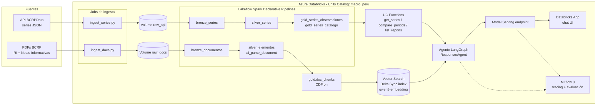

# PLAN.md — Analista Macro Perú: tu primer agente de IA en Databricks

> Plan maestro para construir, probar y desplegar un agente de IA en Azure Databricks con datos reales del BCRP (API + PDFs), con infraestructura como código, CI/CD y evaluación. Al final, este proyecto alimenta la presentación.
>
> **Cómo usarlo con Claude Code:** deja este archivo y `CLAUDE.md` en la raíz del repo. Ejecuta fase por fase con prompts como *"Ejecuta la Fase 2 del PLAN.md. Antes de escribir código, muéstrame qué archivos vas a crear."* Cada fase tiene tareas, archivos, comandos y **criterios de aceptación**. No avances a la siguiente fase hasta cumplirlos. Marca las casillas `[ ]` → `[x]` a medida que avances.
>
> **Convención de este documento:** ⚠️ VERIFICAR = supuesto que hay que confirmar contra la documentación o la API real antes de darlo por bueno (cambian rápido). 👤 MANUAL = paso que hace Daniel, no Claude Code.

---

## Índice

0. [Resumen del caso](#0-resumen-del-caso)
1. [Arquitectura y decisiones](#1-arquitectura-y-decisiones)
2. [Prerrequisitos](#2-prerrequisitos)
3. [Estructura del repositorio](#3-estructura-del-repositorio)
4. [Convenciones de datos](#4-convenciones-de-datos)
5. [Fases de implementación](#5-fases-de-implementación)
   - F0 Bootstrap del repo y entorno local
   - F1 Exploración local de fuentes (API + PDFs)
   - F2 Bootstrap de Azure (estado remoto + identidad para CI/CD)
   - F3 Infraestructura con Terraform
   - F4 Bundle base y spike de RAG (**go/no-go**)
   - F5 Ingesta estructurada + medallion de series
   - F6 Pipeline documental productivo + Vector Search
   - F7 Tools como UC Functions
   - F8 Agente (LangGraph + ResponsesAgent)
   - F9 Evaluación con MLflow 3
   - F10 Despliegue: Model Serving + Databricks App
   - F11 CI/CD con GitHub Actions
   - F12 Observabilidad, costos y teardown
   - F13 Insumos para la presentación
6. [Dataset de evaluación (semilla)](#6-dataset-de-evaluación-semilla)
7. [Riesgos y mitigaciones](#7-riesgos-y-mitigaciones)
8. [Costos y teardown](#8-costos-y-teardown)
9. [Supuestos a verificar](#9-supuestos-a-verificar)

---

## 0. Resumen del caso

**Nombre:** Analista Macro Perú (`macro-peru-agent`)

**Problema:** un analista de banca, fintech o consultoría necesita responder preguntas como *"¿subió el dólar este trimestre y qué explicación dio el BCRP?"* o *"¿cómo cambió la proyección de inflación entre el RI de marzo y el de junio?"*. Hoy cruza BCRPData, Excel y PDFs de ~190 páginas a mano.

**Solución:** un agente que combina:
- **Tools estructuradas** (UC Functions sobre tablas gold) para **datos observados** que vienen de la API del BCRP: tipo de cambio, inflación, tasa de referencia y PBI.
- **RAG** (Vector Search) sobre **Reportes de Inflación** y **Notas Informativas del Programa Monetario** para **explicaciones, riesgos y proyecciones**. Las proyecciones solo existen en los documentos.

**Regla de oro del agente:**

| Tipo de pregunta | Fuente |
|---|---|
| Dato observado (qué pasó) | API vía tools |
| Proyección o explicación (qué se espera, por qué) | Documentos vía RAG |
| Si discrepan | Mostrar ambos, cada uno con su fecha |

**Mensajes pedagógicos del caso (para la presentación):**
1. No todo es RAG: los números observados se consultan con SQL gobernado.
2. RAG con datos que cambian en el tiempo necesita metadata temporal y filtros; si no, mezcla cifras de reportes distintos.
3. Un agente sin evaluación es un demo, no un producto.
4. Todo es código: infraestructura (Terraform), recursos de Databricks (bundles) y despliegue (GitHub Actions).

---

## 1. Arquitectura y decisiones

### 1.1 Diagrama



### 1.2 Decisiones

| Tema | Decisión | Razón |
|---|---|---|
| Nube y región | Azure, **East US 2** | Región de EE. UU.: Foundation Model APIs pay-per-token sin cross-Geo. ⚠️ VERIFICAR la disponibilidad de modelos en la región |
| Workspace | Azure Databricks **Premium**, Unity Catalog, compute **serverless** | UC obligatorio; serverless evita gestionar clusters y cuotas de vCPU |
| Infraestructura Azure + base UC | **Terraform** (`azurerm`, `azuread`, `databricks`) | Recursos de nube, identidad y gobierno base |
| Recursos Databricks | **Declarative Automation Bundles** (ex Asset Bundles), CLI reciente | Jobs, pipelines, Vector Search, serving y app como código |
| CI/CD | **GitHub Actions** + **OIDC** (federated credentials, sin secretos) | Buenas prácticas de seguridad |
| Pipelines de datos | **Lakeflow Spark Declarative Pipelines** (SQL + Python) | Medallion declarativo con expectations |
| Parsing de PDFs | `ai_parse_document` v2.0 (GA abr-2026) | Tablas en HTML, secciones, páginas |
| Embeddings | `databricks-qwen3-embedding-0-6b` (multilingüe, Public Preview). Plan B: Azure OpenAI `text-embedding-3-small` como external model | Corpus en español |
| Índice | Vector Search, endpoint STANDARD, índice **Delta Sync** con embeddings gestionados, búsqueda **HYBRID** | Simplicidad + match exacto de términos técnicos |
| LLM del agente | Variable del bundle `llm_endpoint`. Candidatos: un modelo Claude o GPT disponible en el workspace | ⚠️ VERIFICAR en Serving qué endpoints existen |
| Framework del agente | **LangGraph** + `databricks-langchain`, envuelto en **MLflow `ResponsesAgent`** | Patrón recomendado, tracing automático |
| Evaluación | `mlflow.genai.evaluate` con scorers integrados + scorers propios (recall@k, citas) | Gate de calidad en CI |
| Serving | `databricks.agents.deploy()` → Model Serving (scale-to-zero) | Tracing, inference tables, review app |
| UI | **Databricks App** (Streamlit o Gradio) que llama al endpoint | Demo visual para la presentación |
| Gestión de Python | `uv` + `pyproject.toml` | Rápido y reproducible |

### 1.3 Reparto de responsabilidades (importante para no mezclar)

| Herramienta | Gestiona | NO gestiona |
|---|---|---|
| `infra/bootstrap` (Terraform, local, una vez) | Storage del tfstate, App Registration + SP, federated credentials de GitHub, role assignments | Workspace |
| `infra/terraform` (Terraform, CI) | Resource group, ADLS Gen2, Access Connector, workspace, storage credential, external location, catálogo, schemas, volumes, grants, SP en el workspace, budget | Jobs, pipelines, índices, endpoints |
| Bundle (`databricks.yml`) | Jobs, pipelines, Vector Search endpoint/índice, experiments, serving, app | Infra de Azure, catálogo |
| GitHub Actions | Orquesta `terraform` + `bundle` + evaluación | — |

---

## 2. Prerrequisitos

### 2.1 Cuentas 👤 MANUAL
- [ ] Suscripción Azure **Pay-As-You-Go** personal (la free account suele tener cuotas bajas). Ser **Owner** de la suscripción y poder crear App Registrations en Entra ID.
- [ ] Cuenta GitHub con un repo nuevo **`macro-peru-agent`** (privado al inicio).
- [ ] Email para alertas de presupuesto.

### 2.2 Herramientas locales
| Herramienta | Versión mínima | Verificación |
|---|---|---|
| Azure CLI | 2.60+ | `az version` |
| Terraform | 1.7+ | `terraform version` |
| Databricks CLI | la más reciente (≥ 0.287, ya con nombre Declarative Automation Bundles) | `databricks version` |
| Python | 3.11 o 3.12 | `python --version` |
| uv | reciente | `uv --version` |
| GitHub CLI | reciente | `gh --version` |
| Git | — | — |

### 2.3 Logins 👤 MANUAL
```bash
az login
az account set --subscription "<SUBSCRIPTION_ID>"
gh auth login
# Después de F3, cuando exista el workspace:
databricks auth login --host https://<workspace-url>  # perfil "macro-dev"
```

---

## 3. Estructura del repositorio

```
macro-peru-agent/
├── CLAUDE.md                     # contexto para Claude Code
├── PLAN.md                       # este archivo
├── README.md
├── pyproject.toml                # uv; deps de dev y del proyecto
├── databricks.yml                # bundle raíz (targets dev/prod, variables)
├── resources/                    # recursos del bundle
│   ├── jobs.ingest_series.yml
│   ├── jobs.ingest_docs.yml
│   ├── jobs.build_chunks.yml
│   ├── jobs.setup_uc_functions.yml
│   ├── jobs.evaluate_agent.yml
│   ├── jobs.deploy_agent.yml
│   ├── pipelines.series.yml
│   ├── pipelines.documents.yml
│   ├── vector_search.yml         # ⚠️ VERIFICAR claves con `databricks bundle schema`
│   ├── experiments.yml
│   └── apps.chat.yml
├── config/
│   ├── series.yml                # catálogo curado de series BCRP (código, alias, unidad, frecuencia)
│   └── documentos.yml            # manifiesto curado de PDFs (url, tipo, fecha, periodo)
├── src/macro_peru/
│   ├── __init__.py
│   ├── bcrp/
│   │   ├── client.py             # cliente de la API BCRPData
│   │   └── periods.py            # parser de periodos ("Ene.2026", "02.Ene.26", "T1.26"...)
│   ├── ingestion/
│   │   ├── ingest_series.py      # entrypoint del job: API → Volume raw_api
│   │   └── ingest_docs.py        # entrypoint del job: PDFs → Volume raw_docs
│   ├── pipelines/
│   │   ├── series/
│   │   │   ├── bronze.sql
│   │   │   ├── silver.py
│   │   │   └── gold.sql
│   │   └── documents/
│   │       ├── bronze.sql
│   │       └── silver.sql        # ai_parse_document + explode de elementos
│   ├── chunking/
│   │   └── build_chunks.py       # silver_elementos → gold.doc_chunks (CDF)
│   ├── tools/
│   │   ├── uc_functions.sql      # get_series, compare_periods, list_reports
│   │   └── retriever.py          # search_bcrp_reports (Vector Search con filtros)
│   ├── agent/
│   │   ├── agent.py              # LangGraph + ResponsesAgent (models-from-code)
│   │   ├── prompts.py            # system prompt
│   │   ├── config.py             # lectura de config (endpoints, índice, catálogo)
│   │   ├── log_and_register.py   # mlflow log + registro en UC
│   │   └── deploy.py             # agents.deploy()
│   └── evaluation/
│       ├── scorers.py            # recall@k, citación, temporal
│       └── run_eval.py           # mlflow.genai.evaluate + umbrales (exit code)
├── evals/
│   ├── dataset_v1.jsonl          # preguntas + expectations
│   └── README.md
├── spikes/
│   └── rag_spike.py              # F4: notebook-script del spike (Databricks notebook source)
├── app/
│   ├── app.py                    # UI de chat (Streamlit)
│   ├── app.yaml
│   └── requirements.txt
├── infra/
│   ├── bootstrap/                # se corre UNA vez, local
│   │   ├── main.tf
│   │   ├── variables.tf
│   │   └── outputs.tf
│   └── terraform/
│       ├── backend.tf
│       ├── providers.tf
│       ├── variables.tf
│       ├── main.tf               # RG, storage, access connector, workspace
│       ├── unity_catalog.tf      # credential, external location, catálogo, schemas, volumes, grants
│       ├── identity.tf           # SP en el workspace
│       ├── budget.tf
│       ├── outputs.tf
│       └── envs/dev.tfvars
├── tests/
│   ├── test_periods.py
│   ├── test_client.py            # con respuestas JSON grabadas (fixtures)
│   ├── test_chunking.py
│   └── fixtures/
└── .github/workflows/
    ├── ci.yml                    # PR: lint, tests, tf plan, bundle validate
    ├── deploy-dev.yml            # main: tf apply, bundle deploy dev, eval gate
    └── release-prod.yml          # tag v*: bundle deploy prod
```

---

## 4. Convenciones de datos

### 4.1 Unity Catalog

| Objeto | Nombre |
|---|---|
| Catálogo | `macro_peru` (dev: `macro_peru_dev`) |
| Schemas | `raw` (volumes), `bronze`, `silver`, `gold`, `agents` (functions, modelos, índice) |
| Volumes | `raw.raw_api`, `raw.raw_docs` |
| Modelo registrado | `<catalogo>.agents.macro_peru_agent` |
| Índice | `<catalogo>.agents.doc_chunks_index` |
| Endpoint VS | `vs-macro-peru` |

> El catálogo es variable del bundle (`${var.catalog}`) para separar dev y prod en el mismo workspace.

### 4.2 Tablas principales

**`gold.series_catalogo`**
| columna | tipo | nota |
|---|---|---|
| codigo | STRING | código BCRP (p. ej. `PD04638PD`) |
| alias | STRING | nombre corto para el agente: `tipo_cambio_venta`, `tasa_referencia`, `inflacion_12m`, `pbi_var` |
| nombre | STRING | nombre oficial devuelto por la API |
| frecuencia | STRING | diaria / mensual / trimestral / anual |
| unidad | STRING | S/ por US$, %, var. % |
| descripcion | STRING | para el LLM |

**`gold.series_observaciones`**
| columna | tipo |
|---|---|
| codigo | STRING |
| alias | STRING |
| fecha | DATE (inicio del periodo) |
| periodo_label | STRING (etiqueta original de la API) |
| valor | DOUBLE (NULL si "n.d.") |
| _ingested_at | TIMESTAMP |

**`gold.doc_chunks`** (Delta, **Change Data Feed ON**, PK `chunk_id`)
| columna | tipo | nota |
|---|---|---|
| chunk_id | STRING | hash(doc_id, orden) |
| doc_id | STRING | p. ej. `RI-2026-03`, `NI-2026-02-12` |
| doc_type | STRING | `reporte_inflacion` / `nota_informativa` |
| titulo_doc | STRING | |
| fecha_publicacion | DATE | **clave para filtros** |
| periodo_reporte | STRING | `2026-03` |
| seccion | STRING | último section_header vigente |
| es_recuadro | BOOLEAN | |
| tipo_elemento | STRING | `texto` / `tabla` |
| pagina_inicio | INT | |
| pagina_fin | INT | |
| url | STRING | URL pública del PDF |
| content | STRING | texto a embeber (incluye prefijo de contexto, ver F6) |

---

## 5. Fases de implementación

> Estimaciones de tiempo con Claude Code y asumiendo que todo va bien. Cada fase termina con un commit y, desde F11, con un PR.

---

### F0 — Bootstrap del repo y entorno local (≈ 1 h)

**Objetivo:** repo creado, estructura base y herramientas listas.

**Tareas**
- [x] Verificar las versiones de la sección 2.2 y reportar lo que falte.
- [x] `git init`, crear la estructura de carpetas de la sección 3 (archivos vacíos o con TODO).
- [x] `pyproject.toml` con `uv`:
  - runtime: `requests`, `pyyaml`, `pydantic`, `tenacity`
  - agente: `mlflow[databricks]>=3.1`, `databricks-agents`, `databricks-langchain`, `langgraph`, `databricks-vectorsearch`, `databricks-sdk`, `unitycatalog-ai[databricks]`
  - dev: `pytest`, `ruff`, `pypdf` (solo para exploración local), `pandas`
- [x] `.gitignore` (`.venv`, `.databricks/`, `*.tfstate*`, `.terraform/`, `data/`, `.env`)
- [x] `README.md` mínimo.
- [ ] Crear el repo remoto: `gh repo create macro-peru-agent --private --source . --push`

**Criterios de aceptación**
- `uv sync` corre sin errores.
- `ruff check .` y `pytest` (vacío) pasan.
- El repo existe en GitHub.

**Prompt sugerido:** *"Ejecuta F0 del PLAN.md. Verifica versiones, crea la estructura y el pyproject. No crees el repo remoto hasta que yo confirme."*

---

### F1 — Exploración local de fuentes (≈ 2–3 h)

**Objetivo:** conocer el formato real de la API y de los PDFs antes de diseñar pipelines. Sin Azure todavía.

#### F1.1 API BCRPData

> ✅ Hecho el 2026-10-30. La API está detrás de un filtro anti-bot y tiene varias trampas; ver [`docs/plan-actualizado.md`](docs/plan-actualizado.md).
Formato de URL:
```
https://estadisticas.bcrp.gob.pe/estadisticas/series/api/{codigos-separados-por-guion}/{formato}/{periodo_inicial}/{periodo_final}/{idioma}
```
- Formato `json`. Sin API key.
- Varias series en una llamada solo si **comparten frecuencia**.

**Tareas**
- [x] Definir `config/series.yml` con 8–12 series. **Candidatos (⚠️ VERIFICAR cada código en el buscador de BCRPData y con una llamada real):**
  - Tipo de cambio interbancario venta (diaria), candidato `PD04638PD`
  - Tasa de interés de referencia (mensual)
  - Inflación 12 meses, IPC Lima (mensual)
  - Inflación sin alimentos y energía, 12 meses (mensual)
  - Expectativas de inflación a 12 meses (mensual)
  - PBI variación % (mensual y/o anual), candidato anual `PM04863AA`
  - Reservas internacionales netas (diaria o mensual)
  - Precio del cobre (mensual), opcional
- [x] Implementar `bcrp/client.py`:
  - `fetch_series(codes: list[str], start: str, end: str) -> dict` con `tenacity` (reintentos con backoff), timeout de 30 s y User-Agent propio.
  - Agrupar códigos por frecuencia (sufijo del código: `...PD` diaria, `...PM`/`...MM` mensual, `...AA` anual, trimestral ⚠️ VERIFICAR sufijo).
- [x] Llamar a la API real, guardar las respuestas en `tests/fixtures/bcrp_*.json` y **documentar el esquema real** en `evals/README.md` o en un `docs/fuentes.md`. Esquema esperado (⚠️ VERIFICAR):
  ```json
  {
    "config": {"title": "...", "series": [{"name": "...", "dec": "3"}]},
    "periods": [{"name": "Ene.2026", "values": ["3.73"]}]
  }
  ```
- [x] Implementar `bcrp/periods.py`: parsear etiquetas de periodo a `DATE`. Contemplar meses en español abreviados (`Ene, Feb, Mar, Abr, May, Jun, Jul, Ago, Set, Oct, Nov, Dic`; ojo con **"Set"**, no "Sep"), formatos diarios (`02.Ene.26`), trimestrales y anuales, y valores `"n.d."` → `NULL`.
- [x] Tests unitarios de `periods.py` y `client.py` (con fixtures, sin red).

#### F1.2 PDFs del BCRP
Patrones de URL observados:
- RI: `https://www.bcrp.gob.pe/docs/Publicaciones/Reporte-Inflacion/{YYYY}/{mes}/reporte-de-inflacion-{mes}-{YYYY}.pdf`, con `mes` ∈ {marzo, junio, setiembre, diciembre}.
- Notas: `https://www.bcrp.gob.pe/docs/Transparencia/Notas-Informativas/{YYYY}/nota-informativa-{YYYY-MM-DD}.pdf`.

**Tareas**
- [ ] Construir `config/documentos.yml` (manifiesto **curado**, reproducible):
  ```yaml
  documentos:
    - doc_id: RI-2026-03
      doc_type: reporte_inflacion
      titulo: "Reporte de Inflación marzo 2026"
      fecha_publicacion: 2026-03-??   # ⚠️ completar con la fecha real de difusión
      periodo_reporte: "2026-03"
      url: https://www.bcrp.gob.pe/docs/Publicaciones/Reporte-Inflacion/2026/marzo/reporte-de-inflacion-marzo-2026.pdf
    - doc_id: NI-2026-02-12
      doc_type: nota_informativa
      titulo: "Programa Monetario febrero 2026"
      fecha_publicacion: 2026-02-12
      periodo_reporte: "2026-02"
      url: https://www.bcrp.gob.pe/docs/Transparencia/Notas-Informativas/2026/nota-informativa-2026-02-12.pdf
  ```
  - Alcance del **spike**: 2 RI (marzo 2026 y junio 2026) + ~12 notas.
  - Alcance **completo**: RI de 2024 a 2026 + notas del mismo periodo.
  - Las fechas de las notas salen del cronograma de sesiones del Directorio, que se publica en cada nota de diciembre. Validar cada URL con `HEAD` (200 OK).
- [ ] Script `scripts/validate_manifest.py`: valida que todas las URLs respondan y reporta tamaño y número de páginas.
- [ ] Exploración rápida con `pypdf` de un RI: ¿hay texto extraíble (no escaneado)? ¿cómo se ven las tablas de proyecciones? Anotar las secciones típicas (Resumen, Recuadros, etc.).

**Criterios de aceptación**
- `config/series.yml` con códigos **verificados** (cada uno devolvió datos).
- `periods.py` con tests en verde para todas las frecuencias.
- `config/documentos.yml` con URLs que responden 200.
- Nota breve con hallazgos de formato (esquema JSON real, estructura del RI).

**Prompt sugerido:** *"Ejecuta F1. Usa la API real para verificar los códigos; si un código candidato no corresponde a la serie, búscalo y propónme el correcto antes de seguir."*

---

### F2 — Bootstrap de Azure: estado remoto e identidad de CI/CD (≈ 1–2 h)

**Objetivo:** resolver el problema del huevo y la gallina. Se crea, **una sola vez y desde local**, lo que CI/CD necesita para autenticarse y guardar el estado.

**Archivos:** `infra/bootstrap/*.tf` (estado **local**; agregar `infra/bootstrap/terraform.tfstate` al `.gitignore` o guardarlo en un lugar seguro).

**Recursos**
- [ ] `azurerm_resource_group` `rg-macro-peru-tfstate`
- [ ] `azurerm_storage_account` (nombre único, `min_tls_version = "TLS1_2"`, `allow_nested_items_to_be_public = false`) + `azurerm_storage_container` `tfstate`
- [ ] `azuread_application` `sp-macro-peru-cicd` + `azuread_service_principal`
- [ ] `azuread_application_federated_identity_credential` (issuer `https://token.actions.githubusercontent.com`, audience `api://AzureADTokenExchange`):
  - `repo:<usuario>/macro-peru-agent:ref:refs/heads/main`
  - `repo:<usuario>/macro-peru-agent:pull_request`
  - `repo:<usuario>/macro-peru-agent:environment:prod`
- [ ] Role assignments del SP:
  - `Contributor` sobre la suscripción (o un RG dedicado, más estricto, si se prefiere).
  - `User Access Administrator` acotado, **solo si** Terraform debe crear role assignments (el Access Connector necesita `Storage Blob Data Contributor`). Alternativa más segura: crear ese role assignment en bootstrap.
  - `Storage Blob Data Contributor` sobre el storage del tfstate.
- [ ] Outputs: `client_id`, `tenant_id`, `subscription_id`, `tfstate_storage_account`.

**👤 MANUAL después de aplicar**
```bash
cd infra/bootstrap && terraform init && terraform apply
# Variables (no secretos) en GitHub:
gh variable set AZURE_CLIENT_ID --body "<client_id>"
gh variable set AZURE_TENANT_ID --body "<tenant_id>"
gh variable set AZURE_SUBSCRIPTION_ID --body "<subscription_id>"
gh variable set TFSTATE_STORAGE_ACCOUNT --body "<nombre>"
```
- [ ] Crear el environment `prod` en GitHub con aprobación requerida.

**Criterios de aceptación**
- `az ad sp show --id <client_id>` responde.
- Las variables están en GitHub.
- No hay ningún secreto (client secret) creado: **solo OIDC**.

---

### F3 — Infraestructura con Terraform (≈ 2–3 h)

**Objetivo:** workspace Premium funcional con Unity Catalog configurado para el proyecto.

**Archivos:** `infra/terraform/*`

**`backend.tf`**
```hcl
terraform {
  backend "azurerm" {
    resource_group_name  = "rg-macro-peru-tfstate"
    storage_account_name = "<desde var/CLI -backend-config>"
    container_name       = "tfstate"
    key                  = "macro-peru/dev.tfstate"
    use_oidc             = true   # en CI; en local usa az login
    use_azuread_auth     = true
  }
}
```

**`providers.tf`:** `azurerm ~> 4.x`, `azuread ~> 3.x`, `databricks ~> 1.x` (⚠️ VERIFICAR las últimas versiones estables). El provider `databricks` se configura con `host = azurerm_databricks_workspace.this.workspace_url` y `azure_workspace_resource_id`.

**Recursos (`main.tf`)**
- [ ] `azurerm_resource_group` `rg-macro-peru-dev` en `eastus2`
- [ ] `azurerm_storage_account` ADLS Gen2 (`is_hns_enabled = true`) + container `uc-root`
- [ ] `azurerm_databricks_access_connector` (system-assigned identity)
- [ ] `azurerm_role_assignment` → `Storage Blob Data Contributor` del access connector sobre el storage
- [ ] `azurerm_databricks_workspace` (`sku = "premium"`, nombre `dbw-macro-peru-dev`)
  - Los workspaces nuevos se asignan automáticamente al metastore de UC de la región. ⚠️ VERIFICAR que pasó; si no, `databricks_metastore_assignment`.

**Recursos (`unity_catalog.tf`)**
- [ ] `databricks_storage_credential` (con el access connector)
- [ ] `databricks_external_location` → `abfss://uc-root@<storage>.dfs.core.windows.net/`
- [ ] `databricks_catalog` `macro_peru_dev` con `storage_root` en la external location
- [ ] `databricks_schema`: `raw`, `bronze`, `silver`, `gold`, `agents`
- [ ] `databricks_volume`: `raw.raw_api`, `raw.raw_docs` (managed)
- [ ] `databricks_grants`: el SP de CI/CD con `USE_CATALOG`, `USE_SCHEMA`, `CREATE_TABLE`, `CREATE_FUNCTION`, `CREATE_MODEL`, `READ_VOLUME`, `WRITE_VOLUME`, etc.; tu usuario como owner

**Recursos (`identity.tf`)**
- [ ] `databricks_service_principal` con `application_id = <client_id del bootstrap>` y entitlements (`workspace_access`, `databricks_sql_access`)
- [ ] El SP debe poder crear jobs, pipelines y endpoints; agregarlo al grupo `admins` del workspace es lo más simple para un proyecto personal (documentar el trade-off)

**Recursos (`budget.tf`)**
- [ ] `azurerm_consumption_budget_resource_group` sobre `rg-macro-peru-dev` **y** sobre el RG administrado de Databricks, con alertas al 50%, 80% y 100% (monto en `dev.tfvars`)

**Outputs:** `workspace_url`, `workspace_id`, `catalog_name`.

**Comandos (local, la primera vez)**
```bash
cd infra/terraform
terraform init -backend-config="storage_account_name=<tfstate_sa>"
terraform fmt -check && terraform validate
terraform plan -var-file=envs/dev.tfvars -out=tfplan
terraform apply tfplan     # 👤 confirmar antes
```

**👤 MANUAL después de aplicar**
- [ ] Entrar al workspace y verificar UC (Catalog Explorer → `macro_peru_dev`).
- [ ] En **Serving**, anotar los endpoints de Foundation Models disponibles: LLM candidato y `databricks-qwen3-embedding-0-6b`. Si alguno no está, decidir el plan B.
- [ ] Verificar que **serverless** esté habilitado (jobs, pipelines y notebooks).
- [ ] `databricks auth login --host <workspace_url> --profile macro-dev`

**Criterios de aceptación**
- `terraform plan` sin cambios después del apply (idempotente).
- `databricks catalogs get macro_peru_dev --profile macro-dev` responde.
- Los volumes existen y se puede escribir: `databricks fs cp README.md dbfs:/Volumes/macro_peru_dev/raw/raw_docs/test.md`.

---

### F4 — Bundle base + spike de RAG: **GO / NO-GO** (≈ 1–2 días)

**Objetivo:** validar que el RAG funciona con estos PDFs **antes** de construir todo lo demás.

#### F4.1 Bundle mínimo
**`databricks.yml`**
```yaml
bundle:
  name: macro-peru-agent

include:
  - resources/*.yml

variables:
  catalog:
    description: Catálogo de Unity Catalog
  llm_endpoint:
    description: Endpoint del LLM del agente
    default: "<completar tras F3>"
  embedding_endpoint:
    default: databricks-qwen3-embedding-0-6b
  vs_endpoint:
    default: vs-macro-peru

targets:
  dev:
    mode: development
    default: true
    workspace:
      host: <workspace_url>
    variables:
      catalog: macro_peru_dev
  prod:
    mode: production
    workspace:
      host: <workspace_url>
      root_path: /Workspace/Shared/.bundle/${bundle.name}/${bundle.target}
    variables:
      catalog: macro_peru
    run_as:
      service_principal_name: <client_id>
```
> En `prod` se usa el mismo workspace con otro catálogo (`macro_peru`), que hay que crear en Terraform cuando se llegue a F11.

#### F4.2 Spike (`spikes/rag_spike.py`, formato Databricks notebook source)
Corre en serverless, desplegado con el bundle o importado al workspace.

**Pasos del spike**
1. **Descarga:** leer `config/documentos.yml` (subset del spike) y descargar los PDFs al Volume `raw_docs`. Si el egress del workspace a `bcrp.gob.pe` falla, descargar en local y subir con `databricks fs cp`.
2. **Parsing:**
   ```sql
   CREATE OR REPLACE TABLE macro_peru_dev.silver.spike_parsed AS
   SELECT path,
          ai_parse_document(content, map('version', '2.0')) AS parsed
   FROM READ_FILES('/Volumes/macro_peru_dev/raw/raw_docs/', format => 'binaryFile');
   ```
3. **Inspección:** explotar los elementos (`parsed:document:elements`) y revisar los tipos (`text`, `table`, `section_header`, `figure`, `page_header`, `page_footer`...), las páginas y cómo salen las **tablas de proyecciones** (HTML). Guardar 3 ejemplos en el reporte del spike. ⚠️ VERIFICAR las rutas exactas del VARIANT con el output real.
4. **Chunking:** comparar dos estrategias:
   - **A. Por sección:** acumular elementos `text` hasta el siguiente `section_header` o ~800 tokens; las tablas en chunks propios con su título o caption; descartar headers y footers de página.
   - **B. Tamaño fijo:** ~800 tokens con 100 de overlap, ignorando la estructura.
   - Evaluar también `ai_prep_search` (función de Databricks para preparar el output de `ai_parse_document` para búsqueda) como tercera opción. ⚠️ VERIFICAR la disponibilidad.
5. **Prefijo de contexto en cada chunk** (mejora mucho el retrieval temporal):
   ```
   [Reporte de Inflación marzo 2026 | Sección: Inflación | pp. 45-46]
   <texto del chunk>
   ```
6. **Índices:** crear el endpoint `vs-macro-peru` (STANDARD) y dos índices Delta Sync (uno por estrategia de chunking), con `embedding_source_column = content` y `embedding_model_endpoint_name = databricks-qwen3-embedding-0-6b`, `pipeline_type = TRIGGERED`.
7. **Embeddings plan B (opcional en el spike):** si hay acceso a Azure OpenAI, crear un external model `text-embedding-3-small` y un tercer índice para comparar.
8. **Evaluación de retrieval:** con las ~40 preguntas de la sección 6 (subset del spike), medir **recall@5** y **recall@10** comparando con `expected_doc_id` + `expected_pages`, en dos modos de consulta: `ANN` y `HYBRID`, con y sin filtro por fecha.

**Matriz de experimentos**

| Exp | Chunking | Embedding | Query | Filtro fecha |
|---|---|---|---|---|
| E1 | Sección | qwen3 | ANN | no |
| E2 | Sección | qwen3 | HYBRID | no |
| E3 | Sección | qwen3 | HYBRID | sí |
| E4 | Fijo | qwen3 | HYBRID | sí |
| E5 | Sección | text-embedding-3-small | HYBRID | sí |

**Entregable:** `spikes/REPORTE_SPIKE.md` con la tabla de resultados, ejemplos de aciertos y fallos, costo aproximado (DBUs de AI_FUNCTIONS y Vector Search) y la configuración ganadora.

**Criterios GO**
- recall@5 ≥ **0.80** en la mejor configuración.
- **0 mezclas temporales** en las preguntas de tipo temporal cuando se usa filtro.
- Las tablas de proyecciones se recuperan en ≥ 70% de las preguntas de tipo "proyección en tabla".

**Si es NO-GO:** iterar sobre el chunking (tamaño, separar recuadros, prefijos), probar el reranker de Vector Search si está disponible (⚠️ VERIFICAR) o el embedding plan B. Documentar la decisión.

**Prompt sugerido:** *"Ejecuta F4. Antes de crear el endpoint de Vector Search avísame, porque cobra por hora. Al terminar, genera REPORTE_SPIKE.md con la matriz de resultados."*

---

### F5 — Ingesta estructurada + medallion de series (≈ 3–4 h)

**Objetivo:** series del BCRP actualizadas a diario en tablas gold.

**Job `ingest_series`** (`resources/jobs.ingest_series.yml`)
- Serverless, tarea Python `src/macro_peru/ingestion/ingest_series.py`.
- Parámetros: `catalog`, `start` (default `2015-1`), `mode` (`full` | `incremental`).
- Escribe un JSON por grupo de frecuencia y corrida: `/Volumes/<cat>/raw/raw_api/series/ingest_date=YYYY-MM-DD/<frecuencia>_<run_id>.json`, envolviendo la respuesta con metadata `{ "requested_codes": [...], "fetched_at": "...", "payload": {...} }`.
- Incremental: pedir los últimos ~90 días o 3 meses (los valores recientes pueden revisarse) y dejar que silver deduplique.
- Schedule: diario 08:00 America/Lima (⚠️ el cron del bundle usa `quartz_cron_expression` + `timezone_id`).

**Pipeline `series`** (`resources/pipelines.series.yml`, serverless, `catalog: ${var.catalog}`, `schema: silver` o con publicación por schema según la convención vigente)

- `bronze.sql`
  ```sql
  CREATE OR REFRESH STREAMING TABLE bronze.series_raw
  AS SELECT *, _metadata.file_path AS source_file, current_timestamp() AS _ingested_at
  FROM STREAM read_files('/Volumes/${catalog}/raw/raw_api/series/', format => 'json', multiLine => true);
  ```
- `silver.py`: explotar `payload.periods` × `payload.config.series` (posición i de `values` ↔ serie i), parsear el periodo a `fecha` (lógica de `periods.py` portada a una función de Spark o UDF), `valor` a DOUBLE, y deduplicar por (`codigo`, `fecha`) quedándose con el último `_ingested_at` (usar `AUTO CDC` / `apply_changes` SCD1).
  - Expectations: `codigo IS NOT NULL`, `fecha IS NOT NULL`, `valor` en rangos razonables por alias (warning, no drop).
- `gold.sql`:
  - `gold.series_observaciones`: materialized view = silver + `alias` desde el catálogo.
  - `gold.series_catalogo`: materialized view desde una tabla seed cargada de `config/series.yml` (o tabla gestionada por el job).

**Tests**
- [ ] Unit tests del parser de la explosión con fixtures de F1.

**Criterios de aceptación**
- `databricks bundle deploy -t dev` y `databricks bundle run ingest_series -t dev` funcionan.
- `SELECT alias, min(fecha), max(fecha), count(*) FROM gold.series_observaciones GROUP BY alias` muestra todas las series con fechas recientes.
- Correr dos veces no duplica filas.

---

### F6 — Pipeline documental productivo + Vector Search (≈ 4–6 h)

**Objetivo:** llevar la configuración ganadora del spike a pipelines reproducibles.

**Job `ingest_docs`**
- Lee `config/documentos.yml` (sincronizado con el bundle), descarga **solo** los PDFs nuevos (idempotente por `doc_id`) a `/Volumes/<cat>/raw/raw_docs/<doc_type>/<doc_id>.pdf` y escribe/actualiza la tabla `bronze.documentos_manifest` (doc_id, doc_type, titulo, fecha_publicacion, periodo_reporte, url, path, sha256).

**Pipeline `documents`**
- `bronze.sql`: streaming table desde `read_files(... format => 'binaryFile')`.
- `silver.sql`: `ai_parse_document(content, map('version','2.0'))`, luego explode a `silver.doc_elementos` (doc_path, orden, tipo, contenido, page_id) y join con el manifest para la metadata.
  - ⚠️ Parsear solo los documentos nuevos (streaming) para no repagar el parsing.

**Job `build_chunks`** (Python, tarea posterior al pipeline)
- Aplica la estrategia de chunking ganadora del spike.
- Escribe con `MERGE` en `gold.doc_chunks` (tabla Delta **normal**, no MV) con `delta.enableChangeDataFeed = true`.
- Detecta los recuadros (títulos que empiezan con "Recuadro") → `es_recuadro = true`.

**Vector Search** (`resources/vector_search.yml`, ⚠️ VERIFICAR claves con `databricks bundle schema`; si el recurso da problemas, crearlo con un job Python vía `databricks-vectorsearch` y documentarlo)
- Endpoint `vs-macro-peru`.
- Índice `agents.doc_chunks_index`: Delta Sync, `primary_key = chunk_id`, `embedding_source_column = content`, embeddings gestionados, `pipeline_type = TRIGGERED`, columnas sincronizadas: todas las de metadata.
- Tarea final del job: `index.sync()`.

**Orquestación:** un job `refresh_documents` con tareas `ingest_docs → pipeline documents → build_chunks → sync_index`. Schedule semanal (los documentos son mensuales o trimestrales).

**Criterios de aceptación**
- El corpus completo está indexado (`SELECT doc_type, count(DISTINCT doc_id), count(*) FROM gold.doc_chunks GROUP BY 1`).
- Una consulta de prueba `HYBRID` con filtro `fecha_publicacion >= '2026-06-01'` devuelve solo chunks de documentos posteriores a esa fecha.
- Reejecutar el job no reprocesa documentos ya parseados.

---

### F7 — Tools como UC Functions (≈ 2–3 h)

**Objetivo:** tools gobernadas en Unity Catalog, reutilizables desde el agente, SQL o Genie.

**`src/macro_peru/tools/uc_functions.sql`** (desplegado por el job `setup_uc_functions`)

```sql
CREATE OR REPLACE FUNCTION ${catalog}.agents.list_series()
RETURNS TABLE (alias STRING, nombre STRING, frecuencia STRING, unidad STRING, descripcion STRING)
COMMENT 'Lista las series económicas disponibles del BCRP con su alias. Úsala para saber qué alias pasar a get_series.'
RETURN SELECT alias, nombre, frecuencia, unidad, descripcion FROM ${catalog}.gold.series_catalogo;

CREATE OR REPLACE FUNCTION ${catalog}.agents.get_series(
  serie_alias STRING COMMENT 'Alias de la serie, p. ej. tipo_cambio_venta, inflacion_12m, tasa_referencia',
  fecha_desde DATE COMMENT 'Fecha inicial inclusive (YYYY-MM-DD)',
  fecha_hasta DATE COMMENT 'Fecha final inclusive (YYYY-MM-DD)'
)
RETURNS TABLE (fecha DATE, valor DOUBLE, unidad STRING)
COMMENT 'Devuelve observaciones REALES (no proyecciones) de una serie del BCRP entre dos fechas. Máximo 400 filas; para rangos largos de series diarias usa compare_periods.'
RETURN
  SELECT o.fecha, o.valor, c.unidad
  FROM ${catalog}.gold.series_observaciones o
  JOIN ${catalog}.gold.series_catalogo c USING (alias)
  WHERE o.alias = serie_alias AND o.fecha BETWEEN fecha_desde AND fecha_hasta
  ORDER BY o.fecha
  LIMIT 400;

CREATE OR REPLACE FUNCTION ${catalog}.agents.compare_periods(
  serie_alias STRING,
  p1_desde DATE, p1_hasta DATE,
  p2_desde DATE, p2_hasta DATE
)
RETURNS TABLE (periodo STRING, promedio DOUBLE, minimo DOUBLE, maximo DOUBLE, ultimo DOUBLE, n INT)
COMMENT 'Compara estadísticas (promedio, mínimo, máximo, último valor) de una serie entre dos periodos.'
RETURN ...;

CREATE OR REPLACE FUNCTION ${catalog}.agents.list_reports(
  doc_type STRING COMMENT 'reporte_inflacion, nota_informativa o NULL para todos'
)
RETURNS TABLE (doc_id STRING, doc_type STRING, titulo STRING, fecha_publicacion DATE, url STRING)
COMMENT 'Lista los documentos del BCRP disponibles, ordenados del más reciente al más antiguo. Úsala para resolver "el último reporte" antes de buscar.'
RETURN ...;
```

**`src/macro_peru/tools/retriever.py`**: tool `search_bcrp_reports(query: str, fecha_desde: str | None, fecha_hasta: str | None, doc_type: str | None, k: int = 5)`
- Usa `VectorSearchClient().get_index(...).similarity_search(query_text=..., query_type="HYBRID", filters=..., num_results=k, columns=[...])`. ⚠️ VERIFICAR la sintaxis de filtros con rangos (`"fecha_publicacion >="`) en el SDK vigente.
- Devuelve los chunks con metadata formateada para citar: `[doc_id | titulo | pp. X-Y | url]`.
- Instrumentada con `@mlflow.trace(span_type="RETRIEVER")` y declarando `mlflow.models.set_retriever_schema(...)` para que los judges de retrieval funcionen.

**Criterios de aceptación**
- Cada function se puede probar desde el SQL editor con resultados correctos.
- Tests de `retriever.py` contra el índice real (marcados como `integration`).

---

### F8 — Agente: LangGraph + ResponsesAgent (≈ 4–6 h)

**Objetivo:** un agente que decide entre tools y RAG, cita fuentes y respeta la regla temporal.

**`agent/prompts.py` — system prompt (borrador)**
```
Eres "Analista Macro Perú", un asistente que responde preguntas sobre la economía peruana
usando exclusivamente datos y documentos del Banco Central de Reserva del Perú (BCRP).

Fecha actual: {today}.

Reglas:
1. Datos OBSERVADOS (qué pasó: tipo de cambio, inflación registrada, tasa vigente) → usa get_series o compare_periods. Si no sabes el alias, usa list_series.
2. PROYECCIONES, explicaciones, riesgos y decisiones de política → usa search_bcrp_reports.
3. Si la pregunta menciona "último", "más reciente" o un periodo, primero usa list_reports y luego busca con filtros de fecha. Nunca mezcles cifras de reportes distintos sin decir de cuál viene cada una.
4. Cita siempre: para documentos [Título, fecha, pp.]; para series [serie, rango de fechas, fuente BCRPData].
5. Si un dato observado y un documento discrepan, muestra ambos con su fecha y explica que el documento refleja la información disponible al momento de su publicación.
6. Si la pregunta está fuera del alcance (otros países, recomendaciones de inversión, futuro no proyectado por el BCRP), dilo claramente y no inventes.
7. Responde en español neutro, conciso, con cifras y unidades.
```

**`agent/agent.py`** (patrón *models-from-code*)
- `ChatDatabricks(endpoint=config.llm_endpoint, temperature=0)`.
- Tools: `UCFunctionToolkit(function_names=[f"{cat}.agents.list_series", ...]).tools` + `search_bcrp_reports` como `@tool` de LangChain.
- Grafo LangGraph: `agent ⇄ tools` (ReAct) con límite de iteraciones (p. ej. 8).
- Clase `MacroPeruAgent(ResponsesAgent)` con `predict()` y `predict_stream()`. Seguir el ejemplo oficial de LangGraph + ResponsesAgent de la documentación de Databricks (⚠️ VERIFICAR la versión vigente del ejemplo, porque los nombres de helpers cambian).
- `mlflow.langchain.autolog()` para tracing.
- `mlflow.models.set_model(AGENT)` al final.

**`agent/log_and_register.py`**
- `mlflow.pyfunc.log_model(name="agent", python_model="agent.py", resources=[DatabricksServingEndpoint(llm), DatabricksServingEndpoint(embedding), DatabricksVectorSearchIndex(index), DatabricksFunction(...) x4], pip_requirements=[...], input_example=...)`.
  - Los `resources` son clave: habilitan el passthrough automático de credenciales en serving.
- `mlflow.register_model(uri, f"{cat}.agents.macro_peru_agent")`.

**Pruebas locales y en el notebook**
- [ ] 5 preguntas manuales (una por categoría) y revisión de los traces en MLflow.
- [ ] Verificar en el trace que la pregunta híbrida llama a **ambas** tools.

**Criterios de aceptación**
- El modelo se registra en UC con versión 1.
- Los traces muestran spans de LLM, tools y retriever.
- La pregunta "¿Qué dijo el último Reporte de Inflación sobre la inflación?" llama primero a `list_reports` y luego a la búsqueda con filtro.

---

### F9 — Evaluación con MLflow 3 (≈ 3–4 h)

**Objetivo:** medir la calidad y convertirla en un gate automático de CI/CD.

**Dataset:** `evals/dataset_v1.jsonl` (ver sección 6), formato:
```json
{"inputs": {"input": [{"role": "user", "content": "..."}]},
 "expectations": {"expected_facts": ["..."], "expected_doc_ids": ["RI-2026-03"], "expected_tools": ["search_bcrp_reports"], "categoria": "temporal"}}
```
Cargarlo también como **MLflow Evaluation Dataset** en UC (`agents.eval_dataset_v1`) para versionarlo.

**Scorers (`evaluation/scorers.py`)**
- Integrados (`mlflow.genai.scorers`): `RetrievalGroundedness`, `RetrievalRelevance`, `RelevanceToQuery`, `Correctness` (usa `expected_facts`), `Safety`.
- `Guidelines` personalizados:
  - "La respuesta cita la fuente con nombre de documento y fecha, o la serie y el rango."
  - "La respuesta no presenta proyecciones como datos observados."
  - "Si la pregunta está fuera de alcance, la respuesta lo indica y no inventa."
- Scorers propios con `@scorer`:
  - `doc_recall_at_k`: ¿los `expected_doc_ids` aparecen en los spans RETRIEVER del trace?
  - `tool_selection`: ¿las tools llamadas incluyen las `expected_tools`?
  - `no_temporal_mix`: en las preguntas temporales, ¿todos los chunks recuperados son del documento esperado?

**`evaluation/run_eval.py`**
- `mlflow.genai.evaluate(data=dataset, predict_fn=<agente local o endpoint>, scorers=[...])`.
- Calcula los agregados y **sale con exit code 1** si no se cumplen los umbrales:

| Métrica | Umbral v1 |
|---|---|
| doc_recall_at_k | ≥ 0.80 |
| tool_selection | ≥ 0.90 |
| Correctness | ≥ 0.75 |
| RetrievalGroundedness | ≥ 0.85 |
| no_temporal_mix | 1.00 |
| Fuera de alcance (Guidelines) | 1.00 |

- Job `evaluate_agent` en el bundle (parámetro: versión del modelo o endpoint).

**Criterios de aceptación**
- Una corrida de evaluación visible en el experimento con todas las métricas.
- Reporte `evals/RESULTADOS_v1.md` con métricas, 3 fallos analizados y las acciones tomadas.

---

### F10 — Despliegue: Model Serving + Databricks App (≈ 3–4 h)

**Model Serving**
- `agent/deploy.py`: `from databricks import agents; agents.deploy(model_name, version, scale_to_zero=True, tags={...})`.
- Job `deploy_agent` (parámetro `version`), que se ejecuta solo si `evaluate_agent` pasó (dependencia de tareas en el mismo job: `log_and_register → evaluate → deploy`).
- Verificar: endpoint `READY`, **AI Gateway inference tables** activas y traces de producción llegando al experimento.
- Review App: habilitarla para compartir con 2–3 personas y recoger feedback humano (opcional, suma a la presentación).

**Databricks App** (`app/`, `resources/apps.chat.yml`)
- Streamlit con historial de chat, streaming de la respuesta y un panel lateral "Fuentes" con las citas (enlaces a los PDFs).
- Llama al endpoint con el SDK (`WorkspaceClient().serving_endpoints...` o un cliente OpenAI-compatible apuntando al workspace).
- Recurso del endpoint declarado en la app con permiso `CAN_QUERY`.
- Ejemplos clicables con las 4 preguntas estrella de la demo.

**Criterios de aceptación**
- `databricks bundle deploy -t dev` despliega la app y `databricks bundle run chat_app -t dev` la levanta.
- La pregunta estrella responde en < 30 s con citas correctas.

---

### F11 — CI/CD con GitHub Actions (≈ 3–4 h)

**Autenticación (todas las workflows)**
```yaml
permissions:
  id-token: write
  contents: read

steps:
  - uses: actions/checkout@v4
  - uses: azure/login@v2
    with:
      client-id: ${{ vars.AZURE_CLIENT_ID }}
      tenant-id: ${{ vars.AZURE_TENANT_ID }}
      subscription-id: ${{ vars.AZURE_SUBSCRIPTION_ID }}
  - uses: databricks/setup-cli@main
  # Databricks CLI autenticado vía Azure CLI con el mismo SP:
  - run: echo "DATABRICKS_AUTH_TYPE=azure-cli" >> $GITHUB_ENV
```
Terraform en CI: `ARM_USE_OIDC=true`, `ARM_CLIENT_ID`, `ARM_TENANT_ID`, `ARM_SUBSCRIPTION_ID`.
⚠️ Alternativa a evaluar: workload identity federation **nativa de Databricks** para GitHub (`DATABRICKS_AUTH_TYPE=github-oidc`) con una federation policy en el SP. Es más limpia; VERIFICAR la disponibilidad en Azure.

**`ci.yml`**: on `pull_request`
1. `uv sync` → `ruff check` → `pytest -m "not integration"`
2. `terraform fmt -check`, `validate`, `plan` (comentar el plan en el PR, opcional)
3. `databricks bundle validate -t dev`

**`deploy-dev.yml`**: on `push` a `main`
1. `terraform apply -auto-approve` (solo si hubo cambios en `infra/terraform/**`, con `paths` filter o `dorny/paths-filter`)
2. `databricks bundle deploy -t dev`
3. `databricks bundle run setup_uc_functions -t dev`
4. `databricks bundle run evaluate_agent -t dev` → **gate**: si falla, el workflow falla
5. Si el agente cambió: `databricks bundle run deploy_agent -t dev`

**`release-prod.yml`**: on `push` de tags `v*`, environment `prod` (aprobación manual)
1. `terraform apply` del catálogo prod (si aplica)
2. `databricks bundle deploy -t prod`
3. Ingesta inicial + evaluación + deploy

**Protecciones 👤 MANUAL**
- [ ] Branch protection en `main`: PR obligatorio + `ci.yml` en verde.
- [ ] Environment `prod` con required reviewers.

**Criterios de aceptación**
- Un PR de prueba (cambiar el system prompt) dispara CI en verde.
- El merge despliega en dev y corre la evaluación.
- Un PR que rompe la calidad a propósito (p. ej. quitar la regla temporal del prompt) **falla el gate**. Esto es oro para la presentación.

---

### F12 — Observabilidad, costos y teardown (≈ 2 h)

- [ ] Dashboard AI/BI `macro-peru-ops` (en el bundle): última fecha por serie (frescura), documentos indexados, requests al endpoint, latencia p50/p95 y feedback (desde inference tables y system tables de billing).
- [ ] Alerta SQL: una serie sin actualizar en > 3 días hábiles.
- [ ] Query de costos: `system.billing.usage` filtrado por tags (`project = macro-peru`). Etiquetar todos los recursos del bundle con `custom_tags`.
- [ ] Script `scripts/teardown.sh`:
  ```bash
  databricks bundle destroy -t dev --auto-approve   # jobs, pipelines, índice, endpoint, app
  # Vector Search endpoint si quedó fuera del bundle
  cd infra/terraform && terraform destroy -var-file=envs/dev.tfvars
  ```
- [ ] Script `scripts/pause.sh`: borra **solo** el endpoint de Vector Search y apaga la app (lo que cobra en reposo), sin perder datos. `scripts/resume.sh` los recrea.

---

### F13 — Insumos para la presentación (≈ 2 h, durante todo el proyecto)

> La presentación se construirá después con el formato que Daniel subirá. Esta fase solo **recolecta material**.

- [ ] `presentacion/insumos/` con:
  - Diagrama de arquitectura final (Mermaid → exportar SVG/PNG).
  - Capturas: Catalog Explorer (linaje bronze → gold), pipeline en ejecución, índice de Vector Search, trace de MLflow de la pregunta estrella, resultados de evaluación, workflow de GitHub Actions (incluyendo el gate fallando), app de chat.
  - `metricas.md`: resultados del spike (matriz E1–E5), métricas de evaluación v1, latencia y costo aproximado.
  - `historia.md`: narrativa en 5 actos: problema → datos reales → por qué RAG (y por qué no solo RAG) → calidad medible → todo como código.
  - `demo-script.md`: guion de la demo en vivo con las 4 preguntas estrella y plan B (video grabado) si falla la conexión.
  - `lecciones.md`: errores encontrados y cómo se resolvieron (contenido muy valioso para la audiencia).

---

## 6. Dataset de evaluación (semilla)

> Completar `expected_facts` **leyendo el documento real**; no inventar cifras. Objetivo: ~40 preguntas para el spike y ~60 para v1. Las marcadas con ✔ tienen un dato ya verificado.

| # | Categoría | Pregunta | expected_doc_ids / tools | expected_facts |
|---|---|---|---|---|
| 1 | Notas | ¿Qué decidió el BCRP sobre la tasa de referencia en febrero de 2026? | NI-2026-02-12 | ✔ Mantuvo la tasa de referencia en 4,25% |
| 2 | Notas | ¿Cuándo fue la sesión siguiente a la de febrero 2026? | NI-2026-02-12 | ✔ 12 de marzo de 2026 |
| 3 | Narrativa | ¿Cuándo se aprobó el Reporte de Inflación de marzo 2026? | RI-2026-03 | ✔ Sesión del Directorio del 12 de marzo de 2026 |
| 4 | Narrativa | ¿Cuándo se difundiría el RI siguiente al de marzo 2026? | RI-2026-03 | ✔ Viernes 19 de junio de 2026 |
| 5 | Narrativa | ¿Cuál es la meta de inflación del BCRP? | cualquier RI | ✔ Rango entre 1% y 3% |
| 6 | Narrativa | ¿Qué riesgos para la inflación identifica el RI de junio 2026? | RI-2026-06 | (completar) |
| 7 | Proyección (tabla) | ¿Qué crecimiento del PBI 2026 proyectó el RI de marzo 2026? | RI-2026-03 | (completar desde la tabla) |
| 8 | Proyección (tabla) | ¿Qué inflación proyecta el RI de junio 2026 para el cierre de 2026? | RI-2026-06 | (completar) |
| 9 | Temporal | ¿Qué dice el último Reporte de Inflación sobre el tipo de cambio? | list_reports + último RI | (completar) |
| 10 | Temporal | ¿Cuál fue la última decisión de tasa del BCRP? | list_reports + última NI | (completar) |
| 11 | Comparación | ¿Cómo cambió la proyección de inflación 2026 entre el RI de marzo y el de junio de 2026? | RI-2026-03, RI-2026-06 | (completar ambas cifras) |
| 12 | Comparación | ¿Cambió la proyección de inversión privada entre reportes? | RI-2026-03, RI-2026-06 | (completar) |
| 13 | Observado | ¿Cuál fue el tipo de cambio promedio de septiembre 2026? | get_series / compare_periods | (calcular desde gold) |
| 14 | Observado | ¿Cómo evolucionó la inflación a 12 meses en 2026? | get_series | (calcular) |
| 15 | Híbrida | ¿Subió el dólar en el último trimestre y qué explicación da el BCRP? | compare_periods + search | (completar) |
| 16 | Híbrida | ¿La inflación actual está dentro del rango meta y qué espera el BCRP? | get_series + search | (completar) |
| 17 | Fuera de alcance | ¿Debería comprar dólares hoy? | — | Indica que no da recomendaciones de inversión |
| 18 | Fuera de alcance | ¿Qué hará la Reserva Federal el próximo mes? | — | Indica que está fuera de su alcance |
| 19 | Fuera de alcance | ¿Cuál es la inflación de Chile? | — | Indica que solo cubre datos del BCRP sobre Perú |
| 20 | Trampa | ¿Cuál fue la inflación observada de diciembre 2027? | — | No existe el dato; no lo inventa |

---

## 7. Riesgos y mitigaciones

| Riesgo | Prob. | Impacto | Mitigación |
|---|---|---|---|
| Mezcla de cifras entre reportes | Alta | Alto | Metadata temporal, `list_reports`, filtros, prefijo de contexto, scorer `no_temporal_mix` |
| Tablas de proyecciones mal parseadas | Media | Alto | `ai_parse_document` v2 (HTML), chunk por tabla, validación en el spike |
| Embedding qwen3 en preview falla o cambia | Media | Medio | Plan B text-embedding-3-small; el embedding es variable del bundle |
| LLM no disponible en la región | Baja | Alto | Verificar en F3; East US 2; variable `llm_endpoint` |
| Egress del workspace bloqueado a bcrp.gob.pe | Baja | Medio | Descarga local + `databricks fs cp` |
| Cambio de formato de la API | Baja | Medio | Fixtures + tests + expectations |
| Costos por recursos olvidados (VS, serving, app) | Media | Medio | Budget alerts, scale-to-zero, `pause.sh`, tags |
| Recursos de VS en bundles con claves distintas a las supuestas | Media | Bajo | `databricks bundle schema`; fallback a job Python con el SDK |
| Demo en vivo falla (red, cold start) | Media | Alto | Calentar el endpoint antes, video de respaldo |
| Cuotas de la suscripción | Media | Medio | Serverless; Pay-As-You-Go |

---

## 8. Costos y teardown

**Lo que cobra mientras existe (aunque no se use):**
- Endpoint de **Vector Search** → el más importante de vigilar.
- **Databricks App** encendida.
- Storage (mínimo).

**Lo que cobra por uso:**
- Serverless de jobs y pipelines, `ai_parse_document` (AI_FUNCTIONS, una vez por documento), embeddings y LLM pay-per-token, Model Serving (con scale-to-zero se acerca a cero en reposo).

**Disciplina:**
1. Budget con alertas desde el día 1 (F3).
2. Entre sesiones de trabajo: `scripts/pause.sh`.
3. Después de la presentación: `scripts/teardown.sh` completo (o mantener solo storage + tablas).
4. Revisar `system.billing.usage` semanalmente.

> No hay cifras fijas en este plan a propósito: los precios por DBU y por endpoint cambian. En F12 se calcula el costo real con system tables y eso va a la presentación.

---

## 9. Supuestos a verificar

Lista consolidada de los ⚠️ VERIFICAR (Claude Code debe confirmarlos antes de depender de ellos):

1. Códigos exactos de las series del BCRP y esquema JSON de la respuesta (F1).
2. Sufijos de frecuencia para series trimestrales (F1).
3. Fechas de publicación reales de cada documento del manifiesto (F1).
4. Versiones estables de los providers de Terraform (F3).
5. Auto-asignación del metastore de UC en el workspace nuevo (F3).
6. Endpoints de Foundation Models disponibles en East US 2: LLM y `databricks-qwen3-embedding-0-6b` (F3).
7. Rutas del VARIANT de `ai_parse_document` v2.0 y disponibilidad de `ai_prep_search` (F4).
8. Claves de los recursos `vector_search_endpoint` y `vector_search_index` en bundles (`databricks bundle schema`) (F6).
9. Sintaxis de filtros por rango y `query_type="HYBRID"` en `databricks-vectorsearch`, y disponibilidad del reranker (F7).
10. Ejemplo oficial vigente de LangGraph + `ResponsesAgent` y helpers de conversión de mensajes (F8).
11. Nombres y firmas actuales de los scorers en `mlflow.genai.scorers` (F9).
12. Recurso `apps` en bundles y forma de declarar el permiso sobre el serving endpoint (F10).
13. Autenticación de Databricks CLI en GitHub Actions: `azure-cli` vs `github-oidc` nativo (F11).

---

## Cronograma orientativo

| Bloque | Fases | Esfuerzo |
|---|---|---|
| Fundaciones | F0–F3 | 1 día |
| Validación RAG | F4 | 1–2 días |
| Datos productivos | F5–F6 | 1–1.5 días |
| Agente y calidad | F7–F9 | 1.5–2 días |
| Despliegue y CI/CD | F10–F11 | 1–1.5 días |
| Cierre | F12–F13 | 0.5 días |
| **Total** | | **≈ 6–8 días de trabajo** |
