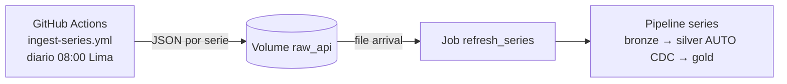

# macro-peru-agent

Analista Macro Perú: agente de IA en Azure Databricks que combina datos observados de la API BCRPData (tools sobre tablas gold) con RAG sobre Reportes de Inflación y Notas Informativas del BCRP.

Proyecto educativo con datos reales, preparado para el **Iquitos Data Fest**.

- Plan por fases: [`PLAN.md`](PLAN.md)
- Plan actualizado y hallazgos sobre las fuentes: [`docs/plan-actualizado.md`](docs/plan-actualizado.md)
- Contexto para Claude Code: [`CLAUDE.md`](CLAUDE.md)

## Entorno local

```bash
uv sync                      # runtime + dev
uv sync --extra agent        # + dependencias del agente (F7 en adelante)
uv run ruff check .
uv run pytest -m "not integration"
```

## Estado

| Fase | Estado |
|---|---|
| F0–F3 Repo, fuentes, Azure y Terraform | ✅ |
| F5 Ingesta de series + medallion | ✅ |
| F1.2 PDFs, F4 spike RAG, F6 en adelante | ⏳ |

## Flujo de series (F5)



- La ingesta corre en GitHub Actions y no en Databricks: la API del BCRP exige pasar un filtro anti-bot con Chromium headless, y el cómputo serverless no tiene sus librerías de sistema. Ver [`docs/plan-actualizado.md`](docs/plan-actualizado.md).
- Autenticación por OIDC (sin secretos). Variables de GitHub: `AZURE_CLIENT_ID`, `AZURE_TENANT_ID`, `AZURE_SUBSCRIPTION_ID`, `DATABRICKS_HOST`.
- Tablas resultantes en `macro_peru_dev`: `gold.series_observaciones` y `gold.series_catalogo`.

```bash
# Desplegar y correr en dev
databricks bundle deploy -t dev --profile macro-dev
databricks bundle run series -t dev --profile macro-dev

# Ingesta manual (local o en Actions)
uv run python -m macro_peru.ingestion.ingest_series --out-dir data/landing --mode full
gh workflow run ingest-series.yml -f mode=incremental
```
