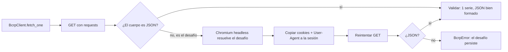

# Plan actualizado: lo que cambió al tocar los datos reales

> Actualizado: 2026-10-30. Complementa a [`PLAN.md`](../PLAN.md). Ese documento sigue siendo el plan maestro; aquí se registra lo que aprendimos al conectarnos a las fuentes reales del BCRP y cómo cambia lo que haremos.

## Estado

| Fase | Estado | Nota |
|---|---|---|
| F0 Bootstrap del repo | ✅ Hecha | Python 3.12 con `uv`, `ruff` y `pytest` en verde. Falta crear el repo remoto (pendiente de confirmación). |
| F1.1 API BCRPData | ✅ Hecha | Cliente con bypass del filtro anti-bot, 11 series verificadas, 36 tests. |
| F1.2 PDFs del BCRP | 🔄 En curso | El sitio web exige verificación humana; los PDFs se descargan a mano (sección 1). |
| F2 en adelante | ⏳ Pendiente | Sin cambios de alcance, con los ajustes de la sección 5. |

---

## 1. El hallazgo: la API pública no deja entrar a los programas

El plan suponía que la API de BCRPData es una API REST simple: una URL y JSON de respuesta, sin API key. En la práctica, **está detrás de Incapsula (Imperva)**, un firewall de aplicaciones que filtra bots.

Cualquier cliente que no ejecute JavaScript recibe, **con status 200**, una página HTML titulada *"Pardon Our Interruption"* en lugar del JSON. Como el status es 200, un cliente ingenuo no ve un error: ve "datos" que no puede parsear.

### Evidencia (pruebas del 2026-10-30)

| Prueba | Red local | Azure East US 2 |
|---|---|---|
| API con `curl` o `requests` (cualquier User-Agent, HTTP/1.1, HTTP plano) | ❌ Página del desafío | ❌ Página del desafío |
| API con Chromium headless (Playwright) | ✅ JSON (~8 s) | ✅ JSON (~15 s) |
| API con `requests` + cookies obtenidas por Chromium | ✅ JSON | ✅ (mismo mecanismo) |
| PDF de un Reporte de Inflación con `curl` | ❌ 403 | ❌ Página del desafío con status 200 (6183 bytes, no es un PDF) |
| PDF o páginas de `www.bcrp.gob.pe` con Chromium headless | ❌ 403 | ❌ Iframe de verificación interactiva (tipo CAPTCHA) |

La prueba en Azure se hizo con un Azure Container Instance temporal (eliminado al terminar) para simular la red desde la que corren los jobs.

### Conclusiones

1. No importa el cliente HTTP: Incapsula exige ejecutar un desafío en JavaScript.
2. Un navegador headless lo resuelve y deja cookies (`visid_incap_*`, `incap_ses_*`) válidas para llamadas HTTP normales, siempre que se envíen con el mismo User-Agent.
3. El sitio web (`www.bcrp.gob.pe`, donde están los PDFs) usa un modo más estricto: pide verificación interactiva incluso a un navegador headless. **No se automatiza**, porque evadir un CAPTCHA ya no es usar datos públicos con cuidado, es saltarse un control explícito.
4. **Lección dentro de la lección:** la primera prueba de PDFs desde Azure pareció exitosa (status 200), pero era la página del desafío. Validar el contenido (la firma `%PDF`), no solo el status HTTP.

---

## 2. La solución implementada



- **`src/macro_peru/bcrp/client.py`**: el navegador solo se levanta cuando aparece el desafío, y una sola vez por sesión mientras las cookies sigan vigentes. En la corrida completa de 11 series (22 llamadas), el desafío apareció 3 veces y el cliente lo resolvió solo.
- **`src/macro_peru/bcrp/periods.py`**: convierte las etiquetas de periodo a fechas y da el formato de periodo que espera la API según la frecuencia.
- **`scripts/record_fixtures.py`**: verifica cada código de `config/series.yml` contra la API real y graba las respuestas en `tests/fixtures/`.
- **Tests sin red** (`tests/test_client.py`, `tests/test_periods.py`): simulan el desafío, el reintento, el desafío persistente, los códigos inválidos y los dos encodings, y parsean todos los fixtures reales.

> Uso responsable: son datos públicos y de libre acceso. La ingesta hace una corrida diaria con unas pocas decenas de llamadas, sin ráfagas ni paralelismo. Si el BCRP endurece el filtro, la ingesta automática falla con un error explícito y el agente sigue respondiendo con los datos ya cargados.

---

## 3. Otras trampas de la API (no documentadas)

Aparecieron al revisar las respuestas reales. Todas están cubiertas por tests.

| # | Trampa | Riesgo si no se maneja | Cómo se resolvió |
|---|---|---|---|
| 1 | Al pedir varias series en una llamada, la API **las reordena por código**. | Asignar valores a la serie equivocada sin ningún error. Por ejemplo, PBI etiquetado como inflación. | Una serie por llamada. |
| 2 | Si se mezclan frecuencias en una llamada, **descarta en silencio** las que no coinciden con la primera. | Series que "desaparecen". | Una serie por llamada. |
| 3 | El encoding **varía por serie** (UTF-8 o Latin-1) y el header siempre dice `text/html`. | Acentos rotos en nombres de series: "Pol�tica". | Decodificar como UTF-8 y, si falla, como Latin-1. |
| 4 | Septiembre aparece como **"Sep"** en series mensuales y como **"Set"** en diarias. | Fechas que no se pueden parsear o filas descartadas. | El parser acepta ambas. |
| 5 | Un código inexistente devuelve **status 200 con JSON mal formado**. | Fallo críptico río abajo. | `BcrpError` con un mensaje claro. |
| 6 | Hay valores `"n.d."` en los últimos días (dato aún no publicado). | Ceros falsos o casteos fallidos. | Se convierten en `NULL`. |
| 7 | El formato del periodo de consulta depende de la frecuencia: `2026-10-01`, `2026-9`, `2026-3` (trimestre) o `2026`. | Respuestas vacías. | `format_period` según la última letra del código. |

---

## 4. Series verificadas

La frecuencia se lee de la **última letra del código**: `D` diaria, `M` mensual, `Q` trimestral (supuesto 2 del plan, ahora confirmado) y `A` anual.

| Alias | Código | Frecuencia | Serie según la API |
|---|---|---|---|
| `tipo_cambio_venta` | PD04638PD | diaria | TC interbancario, venta (S/ por US$) |
| `tasa_referencia` | PD12301MD | diaria | Tasa de referencia de la política monetaria |
| `reservas_internacionales` | PD04650MD | diaria | Reservas internacionales netas (millones US$) |
| `inflacion_12m` | PN01273PM | mensual | IPC Lima, var. % 12 meses |
| `inflacion_sae_12m` | PN01277PM | mensual | IPC sin alimentos y energía, var. % 12 meses |
| `inflacion_subyacente_12m` | PN01279PM | mensual | IPC subyacente, var. % 12 meses |
| `expectativa_inflacion_12m` | PD12912AM | mensual | Expectativa de inflación a 12 meses |
| `pbi_var_12m` | PN01728AM | mensual | PBI, var. % interanual |
| `pbi_var_trimestral` | PN02526AQ | trimestral | PBI por tipo de gasto, var. % real |
| `pbi_var_anual` | PM04863AA | anual | PBI, var. % anual |
| `precio_cobre` | PN01652XM | mensual | Cobre LME (¢US$ por libra) |

Cambios respecto a los candidatos de `PLAN.md`: la tasa de referencia es una serie **diaria** (no mensual). Para la inflación sin alimentos y energía se usa la variación a 12 meses (PN01277PM) y no el índice (PN38707PM). Las reservas se toman en US$ y con frecuencia diaria.

Esquema real de la respuesta (confirma el supuesto 1 del plan):

```json
{
  "config": {"title": "...", "series": [{"name": "...", "dec": "3"}]},
  "periods": [{"name": "15.Oct.26", "values": ["3.42821428571429"]}]
}
```

---

## 5. Cómo cambia lo que haremos

| Fase | Cambio |
|---|---|
| **F1.2** | Los PDFs se **descargan a mano** desde el navegador a `data/pdfs/` y se suben al Volume `raw_docs` con `databricks fs cp`. `config/documentos.yml` sigue siendo el manifiesto curado; `scripts/validate_manifest.py` valida los archivos locales (firma `%PDF`, páginas, sha256) en lugar de las URLs. |
| **F3** | Al crear el workspace, verificar también que serverless tenga salida a internet hacia `bcrp.gob.pe`. |
| **F4 / F6** | `ingest_docs` deja de descargar: registra en `bronze.documentos_manifest` los PDFs ya subidos al Volume (idempotente por `doc_id` y sha256). El resto del pipeline documental no cambia. |
| **F5** | **Nuevo punto a verificar:** si Chromium (Playwright) corre en un job serverless, porque necesita librerías del sistema. Si corre, `ingest_series` usa `BcrpClient` tal cual. Si no corre, el **plan B** es que la ingesta de series la haga un workflow programado de GitHub Actions (también con IP de Azure, con Playwright soportado y autenticado por OIDC) que suba los JSON al Volume `raw_api`. El resto del medallion no cambia. |
| **F5 (silver)** | Mapear valores por código de serie, nunca por posición. Reusar `periods.py` como UDF. |
| **F11** | Si se usa el plan B, el workflow de ingesta se suma a los de CI/CD. |
| **Riesgos (§7)** | Riesgo nuevo: *"Filtro anti-bot del BCRP endurece reglas"*, probabilidad media, impacto medio. Mitigación: error explícito, datos ya ingeridos siguen disponibles y existe el fallback manual (descarga local y `databricks fs cp`). |

---

## 6. Valor agregado para la presentación

Este hallazgo refuerza los mensajes del caso con una historia real:

1. **"Los datos reales nunca son como dice la documentación."** Una API "pública, sin API key" resultó estar detrás de un WAF anti-bot, con un status 200 que miente.
2. **"Validar contra la realidad antes de diseñar"** (por eso existe F1). Si hubiéramos construido el pipeline directo en Databricks, el primer síntoma habría sido un error de parsing de JSON sin una causa evidente.
3. **"Los bugs silenciosos son los peligrosos."** El reordenamiento de series y el descarte por frecuencia no generan errores: generan datos incorrectos. Para un agente que responde preguntas económicas, eso significa que el agente "miente" con confianza.
4. **"La red importa":** el mismo recurso responde distinto según desde dónde se llame (local vs. Azure). Probarlo desde la red real de producción ahorró días de diagnóstico.
5. **"Todo con tests":** cada trampa quedó fijada con un test y con fixtures reales; si el BCRP cambia el formato, el CI lo detecta.

**Idea de slide:** tabla de dos columnas, "Lo que decía el plan" vs. "Lo que encontramos", con las 7 trampas, y una demo en vivo de `curl` contra la API (que devuelve la página del desafío) frente al cliente funcionando.

---

## 7. Próximos pasos

1. F1.2: armar `config/documentos.yml` y validar las URLs (desde Azure o con Playwright).
2. Explorar un Reporte de Inflación con `pypdf`.
3. Crear el repo remoto en GitHub (pendiente de tu confirmación).
4. F2: bootstrap de Azure.
