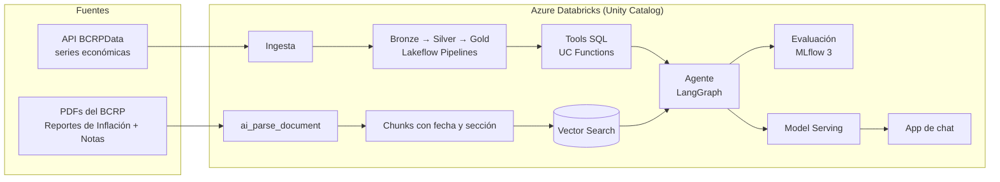

# Brief para generar la presentación: "Analista Macro Perú"

> **Instrucciones para Claude (chat):** con este documento, ayúdame a construir la presentación de mi charla para el **Iquitos Data Fest**. Antes de generar slides, propón una estructura (títulos de slide + idea principal de cada una) y espera mi aprobación. Usa español neutro, tono cercano y técnico. **No inventes cifras:** todo número que no aparezca aquí va como `[DATO PENDIENTE]`. Cuando una slide necesite una captura del proyecto real, indícalo como `[CAPTURA: descripción]`. El público mezcla perfiles de datos, ingeniería y negocio, con distinto nivel técnico: cada concepto técnico necesita una frase en lenguaje simple.

---

## 1. Datos de la charla

| Campo | Valor |
|---|---|
| Evento | Iquitos Data Fest |
| Expositor | Daniel Santos (@danielsantos.ai), Senior Data & AI Engineer |
| Título de trabajo | "Analista Macro Perú: tu primer agente de IA en Databricks, con datos reales del BCRP" |
| Duración | [DATO PENDIENTE] |
| Formato | Charla con demo en vivo y video de respaldo |
| Repositorio público | https://github.com/Danzstorm/macro-peru-agent |

---

## 2. El problema (en una frase)

Un analista de banca, fintech o consultoría que quiere responder *"¿subió el dólar este trimestre y qué explicación dio el BCRP?"* hoy tiene que cruzar a mano BCRPData, Excel y PDFs de ~190 páginas.

## 3. La solución

Un **agente de IA** que responde preguntas sobre la economía peruana usando solo fuentes oficiales del Banco Central de Reserva del Perú (BCRP), y que **cita de dónde sale cada dato**. Combina dos tipos de fuentes:

| Tipo de pregunta | Ejemplo | Fuente | Técnica |
|---|---|---|---|
| **Dato observado** (qué pasó) | "¿Cuál fue el tipo de cambio promedio de septiembre?" | API de BCRPData | Consultas SQL gobernadas (tools) |
| **Proyección o explicación** (qué se espera, por qué) | "¿Qué inflación proyecta el BCRP para fin de año?" | Reportes de Inflación y Notas Informativas (PDF) | RAG (búsqueda semántica sobre documentos) |
| Si las dos fuentes discrepan | — | Ambas | Mostrar las dos, cada una con su fecha |

**Regla de oro:** los números observados se consultan, no se "recuerdan". Las explicaciones y proyecciones se buscan en los documentos, y siempre se cita la fuente con su fecha.

---

## 4. Mensajes clave (lo que el público debe llevarse)

1. **No todo es RAG.** Los números observados se consultan con SQL gobernado. RAG es para texto: explicaciones, riesgos y proyecciones.
2. **RAG con datos que cambian en el tiempo necesita metadata temporal.** Sin fechas y filtros, el agente mezcla cifras del reporte de marzo con las del de junio, y lo dice con total seguridad.
3. **Un agente sin evaluación es un demo, no un producto.** La calidad se mide automáticamente y bloquea el despliegue si baja.
4. **Todo es código:** infraestructura (Terraform), recursos de datos (Databricks Asset Bundles) y despliegue (GitHub Actions).
5. **Los datos reales nunca son como dice la documentación** (ver sección 7: es la historia más fuerte de la charla).

---

## 5. Arquitectura

**Explicación en lenguaje simple, pieza por pieza:**

| Pieza | Qué hace | Analogía |
|---|---|---|
| Ingesta + medallion (bronze/silver/gold) | Trae los datos crudos, los limpia y los deja listos para consultar | Cocina: ingredientes crudos → mise en place → plato servido |
| `ai_parse_document` | Lee los PDFs entendiendo títulos, secciones y tablas | Un asistente que lee el informe y lo separa por capítulos |
| Chunks con metadata | Corta los documentos en trozos con su fecha, sección y página | Fichas de biblioteca: cada una dice de qué libro y página viene |
| Vector Search | Encuentra los trozos más relevantes para una pregunta | Un bibliotecario que entiende de qué trata tu pregunta |
| UC Functions (tools) | Consultas SQL que el agente puede llamar | Una calculadora oficial: no adivina, consulta |
| Agente LangGraph | Decide qué herramienta usar, combina resultados y cita | El analista que decide si buscar en la tabla o en el informe |
| MLflow 3 | Mide la calidad con un set de preguntas y respuestas esperadas | El examen que el agente debe aprobar antes de salir a producción |
| Model Serving + App | Publica el agente y le pone una interfaz de chat | La ventanilla de atención |

**Decisiones técnicas destacables:** Azure Databricks Premium con compute serverless (sin administrar clusters), embeddings multilingües porque el corpus está en español, búsqueda híbrida (semántica + palabras exactas para términos técnicos como "PBI" o "tasa de referencia") y autenticación CI/CD sin secretos (OIDC).

---

## 6. Paso a paso del proyecto (fases)

| Fase | Qué se hace | Por qué importa | Estado |
|---|---|---|---|
| F0 | Repositorio y entorno local | Base reproducible | ✅ |
| F1 | Explorar las fuentes reales antes de diseñar | Aquí aparecieron las sorpresas (sección 7) | ✅ API · 🔄 PDFs |
| F2–F3 | Infraestructura en Azure con Terraform: workspace, Unity Catalog, presupuesto con alertas | Todo como código; costos vigilados desde el día 1 | ⏳ |
| F4 | **Spike de RAG (go/no-go):** comparar estrategias de corte de documentos y tipos de búsqueda; meta: recall@5 ≥ 0.80 | Validar que RAG funciona con estos PDFs antes de construir todo lo demás | ⏳ |
| F5 | Ingesta diaria de series + pipeline medallion | Datos observados siempre frescos | ⏳ |
| F6 | Pipeline documental + índice vectorial | RAG reproducible | ⏳ |
| F7 | Tools como funciones de Unity Catalog | Consultas gobernadas y reutilizables | ⏳ |
| F8 | Agente LangGraph con tracing | El cerebro que decide | ⏳ |
| F9 | Evaluación automática con umbrales | Calidad medible | ⏳ |
| F10 | Despliegue: endpoint + app de chat | Demo para la charla | ⏳ |
| F11 | CI/CD con GitHub Actions + gate de calidad | Un PR que empeora el agente **no se despliega** | ⏳ |
| F12 | Observabilidad, costos y apagado | Proyecto personal sin sorpresas en la factura | ⏳ |

**Matriz del spike de RAG (F4), para una slide:**

| Exp | Corte de documentos | Búsqueda | Filtro por fecha | recall@5 |
|---|---|---|---|---|
| E1 | Por sección | Semántica | No | [DATO PENDIENTE] |
| E2 | Por sección | Híbrida | No | [DATO PENDIENTE] |
| E3 | Por sección | Híbrida | Sí | [DATO PENDIENTE] |
| E4 | Tamaño fijo | Híbrida | Sí | [DATO PENDIENTE] |

**Umbrales de calidad del agente (F9):**

| Métrica | Qué mide | Umbral |
|---|---|---|
| doc_recall_at_k | ¿Encontró el documento correcto? | ≥ 0.80 |
| tool_selection | ¿Usó la herramienta correcta? | ≥ 0.90 |
| Correctness | ¿La respuesta contiene los hechos esperados? | ≥ 0.75 |
| RetrievalGroundedness | ¿Se basa en lo recuperado, sin inventar? | ≥ 0.85 |
| no_temporal_mix | ¿Evitó mezclar reportes de distintas fechas? | 1.00 |
| Fuera de alcance | ¿Rechaza lo que no le corresponde? | 1.00 |

Resultados reales: [DATO PENDIENTE].

---

## 7. La historia real: "la API pública que no deja entrar a los bots"

Esta es la sección con más valor para la charla: hallazgos reales, con evidencia.

**Lo que decía el plan:** "API pública, sin API key, devuelve JSON."

**Lo que encontramos:**

1. **La API está detrás de un firewall anti-bot (Incapsula/Imperva).** Cualquier programa recibe una página HTML que dice *"Pardon Our Interruption"*, **con status 200**. El servidor dice "todo OK" y entrega basura.
2. **Solución:** el cliente detecta el desafío, abre una sola vez un navegador invisible (Chromium headless con Playwright) que resuelve el desafío, y reutiliza esas cookies para las consultas normales. Funciona desde la PC y desde Azure.
3. **El sitio con los PDFs es más estricto:** pide verificación interactiva (tipo CAPTCHA) incluso al navegador invisible. Decisión: **no se automatiza** (evadir un CAPTCHA es saltarse un control explícito). Los PDFs se descargan a mano y se suben a la plataforma. Saber dónde detenerse también es criterio de ingeniería.
4. **Me engañé a mí mismo una vez:** una prueba desde Azure "pasó" con status 200, pero eran 6183 bytes de la página del desafío, no un PDF. Lección: **validar el contenido, no el status.**

**Trampas silenciosas de la API (no documentadas):**

| # | Trampa | Qué habría pasado sin detectarla |
|---|---|---|
| 1 | Al pedir varias series juntas, la API **las reordena** | El agente habría mostrado el PBI como si fuera la inflación, sin ningún error |
| 2 | Si se mezclan frecuencias, **descarta series en silencio** | Series que "desaparecen" |
| 3 | El encoding cambia según la serie (UTF-8 o Latin-1) | "Pol�tica Monetaria" |
| 4 | Septiembre es "Sep" en series mensuales y "Set" en diarias | Fechas que no se pueden leer |
| 5 | Un código inválido devuelve 200 con JSON roto | Errores crípticos lejos de la causa |
| 6 | Valores `"n.d."` (dato aún no publicado) | Ceros falsos |

**Moraleja para la slide:** *"Los bugs silenciosos son los peligrosos: no generan errores, generan respuestas falsas dichas con confianza. En un agente de IA, eso es lo peor que puede pasar."*

**Idea de slide:** dos columnas, "Lo que decía el plan" vs. "Lo que encontramos". **Idea de demo:** `curl` a la API en vivo (sale la página del desafío) vs. el cliente del proyecto devolviendo datos.

---

## 8. Series económicas usadas (verificadas contra la API real)

Tipo de cambio interbancario (venta), tasa de referencia de política monetaria, reservas internacionales netas, inflación a 12 meses (total, sin alimentos y energía, subyacente), expectativa de inflación a 12 meses, PBI (mensual, trimestral y anual) y precio del cobre: 11 series en total.

Documentos: Reportes de Inflación (trimestrales, 2024–2026) y Notas Informativas del Programa Monetario (mensuales).

---

## 9. Demo en vivo (4 preguntas estrella)

| # | Pregunta | Qué demuestra |
|---|---|---|
| 1 | "¿Cuál fue el tipo de cambio promedio de septiembre de 2026?" | Tool SQL: dato observado, con su fuente |
| 2 | "¿Qué dijo el último Reporte de Inflación sobre la inflación?" | Resolver "el último" con fecha y buscar con filtro temporal |
| 3 | "¿Subió el dólar el último trimestre y qué explicación da el BCRP?" | Pregunta híbrida: tool + RAG combinados |
| 4 | "¿Debería comprar dólares hoy?" | Rechazo correcto de lo que está fuera de alcance |

Plan B: video grabado de la demo. [CAPTURA: trace de MLflow de la pregunta 3 mostrando las dos herramientas]

---

## 10. Narrativa sugerida en 5 actos

1. **El problema:** el analista ahogado en PDFs y Excel. Pregunta para abrir: *"¿Cuántos de ustedes copiaron una cifra de un PDF a un Excel esta semana?"*
2. **Datos reales:** la API que no deja entrar a los bots y las trampas silenciosas (sección 7).
3. **Por qué RAG, y por qué no solo RAG:** la regla de oro y el problema temporal.
4. **Calidad medible:** evaluación con umbrales; el PR que empeora el agente y es bloqueado por el CI.
5. **Todo como código:** Terraform + bundles + GitHub Actions; costo real del proyecto [DATO PENDIENTE]; cómo replicarlo desde el repo público.

**Cierre sugerido:** "Un agente útil no es el que más sabe, es el que sabe de dónde sale cada dato y cuándo decir que no sabe."

---

## 11. Material visual pendiente (se completa a medida que avanza el proyecto)

- [CAPTURA: Catalog Explorer con el linaje bronze → silver → gold]
- [CAPTURA: pipeline en ejecución]
- [CAPTURA: índice de Vector Search]
- [CAPTURA: trace de MLflow de la pregunta híbrida]
- [CAPTURA: resultados de evaluación]
- [CAPTURA: GitHub Actions con el gate de calidad fallando]
- [CAPTURA: app de chat respondiendo con citas]
- [CAPTURA: terminal con `curl` devolviendo "Pardon Our Interruption"]
